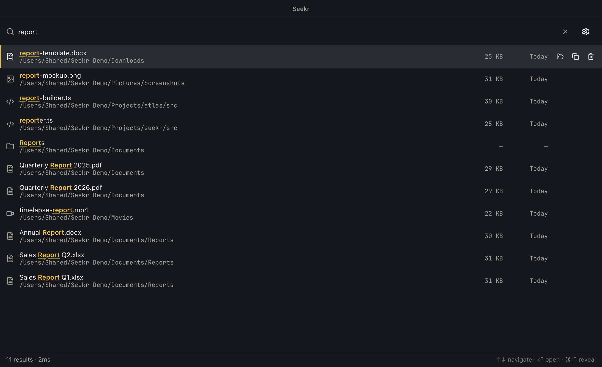
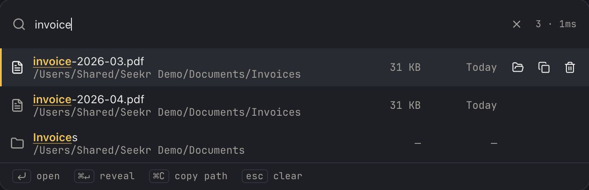
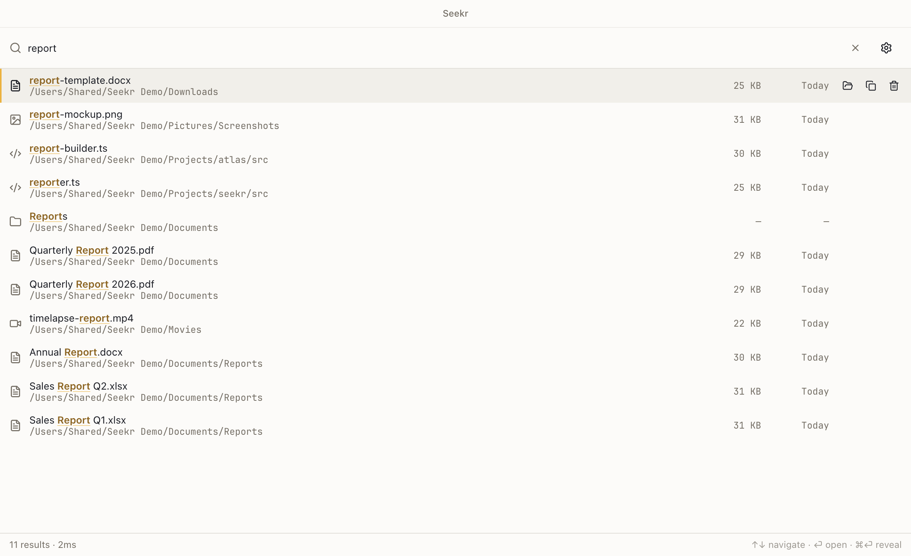
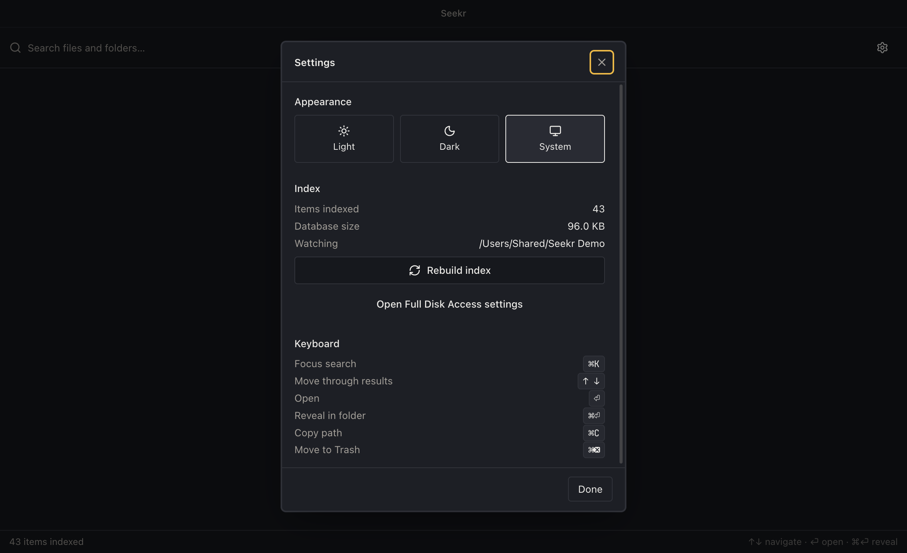

# Seekr

Instant file search for macOS, Windows and Linux. Press a hotkey, type a few
characters, open the file.



## What it does

- **Search as you type** over an index of your files, backed by SQLite's
  trigram full-text index. Substring matches, not just whole words.
- **A hotkey palette** that floats over whatever you were doing, and a full
  window for browsing when you want columns and a scrollback.
- **Keyboard first.** Arrows to move, `⏎` to open, `⌘⏎` to reveal, `⌘C` to copy
  the path, `⌘⌫` to trash. The mouse is optional everywhere.
- **Live updates.** A filesystem watcher keeps the index current; you do not
  re-index to find a file you saved a second ago.
- **Ranked results.** Exact name, then name-without-extension, prefix, word
  boundary, substring — with recent files lifted and build directories sunk.

## Screens

**The palette.** Summoned from anywhere with `⌘⇧F`, floats over full-screen
apps, and sizes itself to the results. Matches are marked in the one accent
colour the design spends anywhere; the bar in the gutter is the keyboard cursor.



**Light and dark.** Both are first-class — warm paper and photographic ink,
with the accent darkened in light mode to hold its contrast.



**Settings.** Real numbers from the engine, and the shortcuts written with the
platform's own glyphs.



## Install

Download the latest build for your platform from
[Releases](https://github.com/k6w/seekr-app/releases/latest).

- **macOS** — universal `.dmg` (Apple Silicon and Intel). Signed and notarized,
  so it opens without a Gatekeeper detour.
- **Windows** — `Setup.exe` installer (x64, arm64) or a portable `.exe`.
- **Linux** — `.AppImage`, `.deb` or `.rpm`.

The app updates itself: it checks on launch and once a day, and asks before
downloading anything.

### macOS permissions

macOS protects `~/Desktop`, `~/Documents`, `~/Downloads` and `~/Library` behind
a privacy setting. Without it, Seekr indexes everything else and tells you which
folders it could not read, with a one-click link to the setting. There is no API
to request Full Disk Access, so this step is manual by design.

## Search syntax

| | |
|---|---|
| `report` | name or path contains "report" |
| `ext:pdf` `ext:pdf,docx` | by extension |
| `type:image` | `document` `image` `video` `audio` `archive` `code` `folder` |
| `size:>10mb` `size:<1gb` | by size |
| `date:today` | `today` `yesterday` `week` `month` `year` |

Operators combine with text: `report ext:pdf date:week`.

## Shortcuts

| | |
|---|---|
| `⌘⇧F` / `Ctrl+Shift+F` | Open the palette from anywhere |
| `⌘K` / `Ctrl+K` | Focus search |
| `↑` `↓` `PgUp` `PgDn` `Home` `End` | Move through results |
| `⏎` | Open |
| `⌘⏎` / `Ctrl+⏎` | Reveal in Finder / Explorer |
| `⌘C` / `Ctrl+C` | Copy path |
| `⌘⌫` / `Ctrl+Del` | Move to Trash |
| `Esc` | Clear, then close |

Results can also be dragged straight into another application.

## Architecture

Three processes, so a full-disk crawl never freezes the window:

```
renderer (palette)  ─┐
                     ├─ MessagePort ─→  engine (utilityProcess)
renderer (window)   ─┘                  SQLite + FTS5 trigram
        │                               crawler + filesystem watcher
        └── IPC ──→ main
                    windows, tray, menu, shell actions, permissions
```

- **The engine** owns the index and every filesystem operation. Renderers get a
  direct `MessagePort` to it, so search traffic never passes through main.
- **Main** owns only what it must: windows, the tray, the menu, and the `shell`
  verbs. Every path from a renderer is validated against the index before it
  reaches the OS.
- **The renderer** is sandboxed, context-isolated, and reaches the rest of the
  app through one allowlisted bridge. There is no general-purpose IPC surface.

## Development

Requires Node 22+ and pnpm 9+.

```bash
pnpm install
pnpm dev            # Vite + Electron with hot reload
```

```bash
pnpm tsc            # type-check both projects
pnpm lint           # lint the repo
pnpm lint:strict    # zero-warning gate for electron/ and tests/
pnpm test           # unit and integration tests
pnpm build          # package for the current platform
```

Two extra checks worth knowing about:

```bash
node scripts/smoke-packaged.cjs   # launch the built app, assert the engine answers
node scripts/bench-search.mjs     # measure query latency against a synthetic corpus
pnpm screenshots                  # regenerate the images above
```

The smoke test is the one that matters before a release. Native modules load
differently from an asar archive than they do in development, so "the build
produced a file" is not evidence that the app runs.

`pnpm screenshots` captures through `webContents.capturePage()` against a
throwaway index, so it never touches your real one and never takes over your
screen or keyboard.

## Licence

MIT. See [LICENSE](LICENSE).
